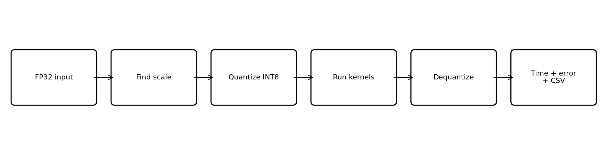
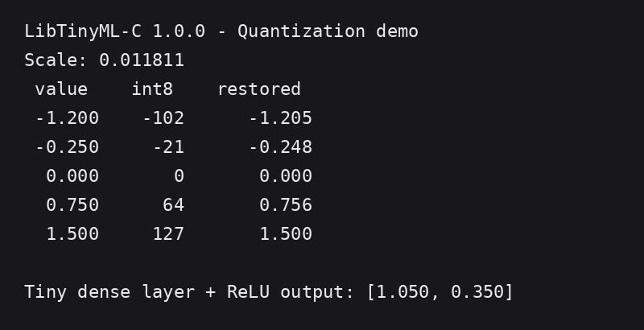
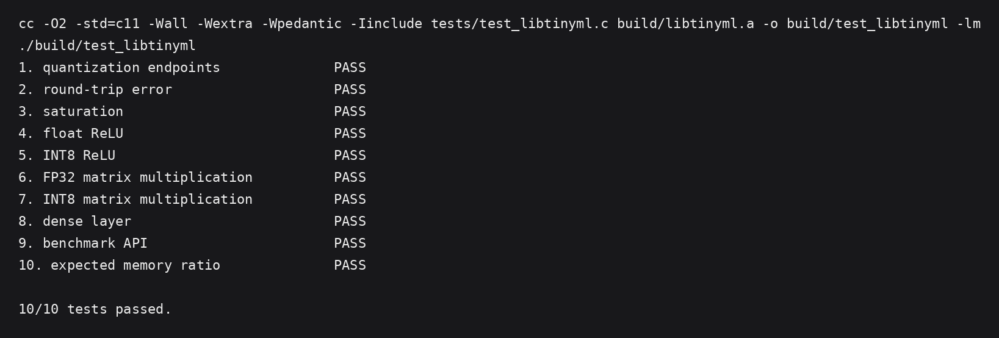
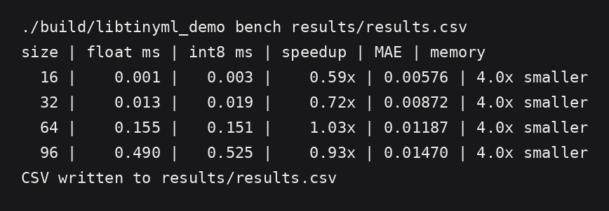
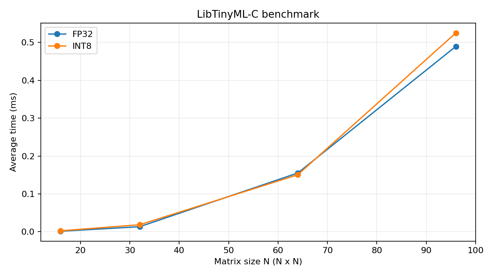

# LibTinyML-C

**A modular static and shared C library for benchmarking quantized Edge-AI arithmetic.**

LibTinyML-C is an educational TinyML/Edge-AI project that compares FP32 and symmetric INT8 arithmetic in plain C. It demonstrates modular library design, quantization/dequantization, matrix multiplication, ReLU, a small dense layer, automated testing, benchmarking, CSV export, and static/shared library builds.

**Mini Hackathon — Batch 09, Team 7**

**Team:** Harshit Karnwal · Arnab Pranjal · Samiksha Frasi · Bhavya  
**Primary implementation and development:** Harshit Karnwal  
**Presentation and project demonstration:** All four team members

## Highlights

- Modular C implementation with a public API in `include/libtinyml.h`
- Static library: `libtinyml.a`
- Shared library: `libtinyml.dylib` on macOS / `libtinyml.so` on Linux
- Symmetric FP32 → INT8 quantization and dequantization
- FP32 and INT8 matrix multiplication
- FP32 and INT8 ReLU
- Tiny dense-layer demonstration
- 10 automated tests
- Repeated benchmark runs with average/min/max timings
- Mean absolute error (MAE) and maximum error reporting
- CSV benchmark export
- Reproducible Makefile workflow

## Why INT8?

For symmetric INT8 quantization:

```text
scale    = max(abs(x)) / 127
q        = clamp(round(x / scale), -127, 127)
x_approx = q * scale
```

An FP32 value occupies 4 bytes while an INT8 value occupies 1 byte. For the input arrays benchmarked here, that gives a **4× memory reduction**. Quantization is approximate, so the project measures its numerical error rather than treating INT8 as lossless.

Performance is also measured rather than assumed. A scalar INT8 C kernel is **not guaranteed to beat optimized FP32 code** on a general-purpose CPU; SIMD/NEON or specialized hardware can change that result.

## Architecture



```text
Application / Tests
        │
        ▼
 include/libtinyml.h
        │
 ┌──────┼──────────┬───────────┐
 ▼      ▼          ▼           ▼
Quant.  Matrix   Activation  Benchmark
        │
        ▼
 Static / Shared Library
```

## Repository layout

```text
LibTinyML-C/
├── include/
│   └── libtinyml.h
├── src/
│   ├── quantization.c
│   ├── matrix.c
│   ├── activation.c
│   ├── benchmark.c
│   └── main.c
├── tests/
│   └── test_libtinyml.c
├── results/
│   └── results.csv
├── screenshots/
│   ├── demo-output.png
│   ├── test-output.png
│   ├── benchmark-output.png
│   └── benchmark-chart.png
├── docs/
│   └── architecture-flow.png
├── Makefile
├── .gitignore
└── README.md
```

## Requirements

- C compiler with C11 support (`clang` or `gcc`)
- `make`
- macOS or Linux

The project uses only the C standard library plus the system math library; no external runtime dependency is required.

## Build

```bash
make clean
make
```

This creates:

- `build/libtinyml.a`
- `build/libtinyml.dylib` on macOS or `build/libtinyml.so` on Linux
- `build/libtinyml_demo`

## Run the demo

```bash
./build/libtinyml_demo demo
```



## Run the tests

```bash
make test
```

The current project contains **10 automated tests** covering quantization, saturation, ReLU, FP32/INT8 matrix multiplication, the dense layer, benchmark result validity, and memory comparison.



## Run the benchmark

```bash
make benchmark
```

The benchmark regenerates `results/results.csv` using repeated FP32 and INT8 matrix-kernel runs. Quantization is performed before the timed kernel section so the comparison focuses on arithmetic execution.



### Sample results

| Matrix size | FP32 avg (ms) | INT8 avg (ms) | FP32/INT8 speed ratio | MAE | Input memory reduction |
|---:|---:|---:|---:|---:|---:|
| 16 | 0.0015 | 0.00255 | 0.588× | 0.005763 | 4× |
| 32 | 0.0134 | 0.01860 | 0.720× | 0.008717 | 4× |
| 64 | 0.1552 | 0.15060 | 1.031× | 0.011865 | 4× |
| 96 | 0.4897 | 0.52533 | 0.932× | 0.014703 | 4× |

These numbers are **sample measurements from the development/build environment**, not universal performance claims. Timing depends on CPU, compiler, optimization, operating system, and system load. Regenerate the CSV on the target machine for a fair comparison.



## Test coverage

The automated suite checks:

1. Known symmetric quantization values
2. Quantize/dequantize round-trip error
3. INT8 saturation behavior
4. FP32 ReLU
5. INT8 ReLU
6. Known 2×2 FP32 matrix multiplication
7. Known 2×2 INT8 matrix multiplication
8. Dense-layer output
9. Benchmark API result validity
10. FP32 vs INT8 input-memory comparison

## C concepts demonstrated

The project uses header files, modular compilation, functions, arrays, pointers, structures, dynamic memory allocation, integer/floating-point arithmetic, type casting, loops, file I/O, command-line arguments, Makefiles, static/shared libraries, and automated tests.

## Limitations

This is an educational CPU implementation, not a production inference engine. The kernels are scalar C rather than SIMD/ARM NEON, the benchmark uses synthetic matrices instead of a trained model dataset, and INT8 speedup is not guaranteed on every CPU. These constraints keep the implementation compact and explainable while still demonstrating the core TinyML concepts.

## Future work

- ARM NEON/SIMD kernels
- Per-channel quantization
- Quantized convolution
- Real TinyML model weights
- Embedded-board benchmarks
- Additional activation functions

## Team

| Member | Contribution |
|---|---|
| **Harshit Karnwal** | Primary implementation and development |
| **Arnab Pranjal** | Presentation and project demonstration |
| **Samiksha Frasi** | Presentation and project demonstration |
| **Bhavya** | Presentation and project demonstration |

All four members participate in the final presentation and project demonstration.
